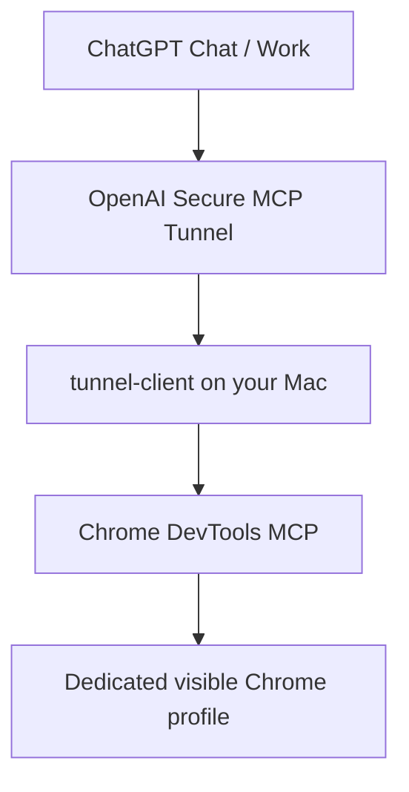

# TabPaw

**A visible, persistent browser bridge for ChatGPT Chat & Work.**

[简体中文](README.zh-CN.md)

TabPaw is a macOS-first setup pattern that connects a dedicated, visible Chrome
profile to supported ChatGPT surfaces through OpenAI Secure MCP Tunnel and
Chrome DevTools MCP.

It keeps the browser on your own Mac, preserves its dedicated profile between
runs, and lets you watch or take over while ChatGPT works. When the same private
plugin is enabled in Chat and Work, both surfaces can use the browser with their
available conversation context and memories.

TabPaw does not fork or redistribute either upstream project. It provides safe
example configuration, helper scripts, and an end-to-end setup guide around:

- [`openai/tunnel-client`](https://github.com/openai/tunnel-client)
- [`ChromeDevTools/chrome-devtools-mcp`](https://github.com/ChromeDevTools/chrome-devtools-mcp)

## Why TabPaw?

- **Real browser state** — a dedicated Chrome profile keeps cookies and sign-ins.
- **Visible work** — Chrome stays on your screen, so you can follow along.
- **Chat + Work** — one private plugin can be available in both supported surfaces.
- **No inbound port** — Secure MCP Tunnel uses an outbound HTTPS connection.
- **Easy recovery** — manual sign-in and troubleshooting steps are documented.
- **Secret-safe examples** — real API keys and tunnel IDs never belong in Git.

## Architecture



## Requirements

- macOS and current Google Chrome
- Node.js LTS with `npm` / `npx`
- Homebrew
- Access to OpenAI Secure MCP Tunnel and custom MCP plugins
- A Platform runtime API key with **Tunnels Read + Use**
- A tunnel associated with the intended ChatGPT workspace or personal account

Availability depends on your OpenAI plan, workspace permissions, and rollout.

## Quick start

1. Install the supported tunnel client:

   ```bash
   brew install openai/tools/tunnel-client
   ```

2. Download this repository and enter its directory:

   ```bash
   git clone https://github.com/1ceve/tabpaw.git
   cd tabpaw
   ```

3. Create a tunnel and a restricted runtime API key in OpenAI Platform. Follow
   [Create the Secure MCP Tunnel](docs/create-tunnel.md), then
   [Create the Runtime API key](docs/create-runtime-api-key.md). Grant only
   **Tunnels Read + Use** to the runtime key for normal use.

4. Copy the example profile:

   ```bash
   mkdir -p "$HOME/.config/tunnel-client"
   cp config/tabpaw.example.yaml "$HOME/.config/tunnel-client/tabpaw.yaml"
   chmod 600 "$HOME/.config/tunnel-client/tabpaw.yaml"
   ```

5. Replace `tunnel_REPLACE_WITH_YOUR_ID` in the copied profile. Keep the real
   profile outside this repository.

6. Put the runtime API key into your current shell without saving it to Git:

   ```bash
   read -s CONTROL_PLANE_API_KEY
   export CONTROL_PLANE_API_KEY
   echo
   ```

7. Diagnose and start from inside the `tabpaw` directory:

   ```bash
   bash scripts/doctor.sh
   bash scripts/start.sh
   ```

   The scripts are optional convenience wrappers. On macOS, the direct start
   command is `caffeinate -i tunnel-client run --profile tabpaw`.

8. In ChatGPT, add a private custom MCP plugin using **Tunnel** as the
   connection and select the same tunnel. Keep the tunnel running while the
   plugin is discovered and used.

Only `tunnel-client` needs to stay running. You do not need to open Chrome in
advance; Chrome DevTools MCP launches the dedicated Chrome automatically when
a browser tool is first used.

For the complete walkthrough, see [macOS setup](docs/setup-macos.md). If
something goes wrong, use the [troubleshooting guide](docs/troubleshooting.md).

## Security model

Treat a signed-in browser as sensitive account access.

- Use a dedicated Chrome profile, separate from everyday browsing.
- Grant the private plugin only to accounts and workspaces you trust.
- Enter passwords and two-factor codes yourself in Chrome, never in chat.
- Keep API keys in environment variables or permission-restricted files.
- Review consequential actions before allowing them to complete.
- Stop `tunnel-client` when you do not want the browser to be reachable.

Read [SECURITY.md](SECURITY.md) before publishing a modified setup.

## Project status

TabPaw is an early, macOS-first guide built from a working personal setup.
Websites may detect or block automated browsers, and their terms still apply.
The project is not affiliated with or endorsed by OpenAI or Google.

## License

Apache License 2.0. See [LICENSE](LICENSE) and
[THIRD_PARTY_NOTICES.md](THIRD_PARTY_NOTICES.md).
