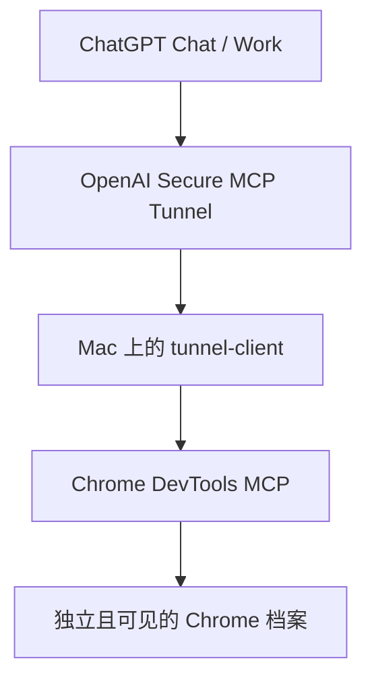

# TabPaw

**让 ChatGPT Chat 与 Work 连接一只真实、可见、保持登录状态的浏览器。**

[English](README.md)

TabPaw 是一套以 macOS 为起点的开源配置与教程。它把一只独立的 Chrome
通过 OpenAI Secure MCP Tunnel 和 Chrome DevTools MCP 接入 ChatGPT。

Chrome 实际运行在自己的 Mac 上，窗口可以看见，专用浏览器档案会在多次启动间保留。
当同一个私有插件同时在 Chat 与 Work 中启用时，两边都能调用这只浏览器，并继续使用各自
已有的对话上下文与可用记忆。

TabPaw 没有复制或重新打包上游项目。它提供的是脱敏示例、辅助脚本和从零配置教程，依赖：

- [`openai/tunnel-client`](https://github.com/openai/tunnel-client)
- [`ChromeDevTools/chrome-devtools-mcp`](https://github.com/ChromeDevTools/chrome-devtools-mcp)

## 它解决什么

- **真实登录状态**：独立 Chrome 档案可以保留 Cookie 和登录状态。
- **过程可见**：浏览器就在自己的屏幕上，可以随时查看或接管。
- **Chat 与 Work 共用**：同一个私有插件可在获得支持的两个界面中使用。
- **无需开放入站端口**：Secure MCP Tunnel 通过主动发出的 HTTPS 连接工作。
- **容易恢复**：人工登录、重启顺序和常见故障都有记录。
- **避免泄密**：示例配置只放占位符，仓库自带秘密扫描脚本。

## 连接结构



## 准备条件

- macOS 与当前稳定版 Google Chrome
- Node.js LTS、`npm` 与 `npx`
- Homebrew
- OpenAI Secure MCP Tunnel 与自定义 MCP 插件权限
- 具有 **Tunnels Read + Use** 权限的 Platform Runtime API key
- 已关联目标 ChatGPT 工作区或个人账户的 tunnel

功能是否出现会受到套餐、工作区权限与灰度范围影响。

## 快速开始

### 1. 安装 tunnel-client

```bash
brew install openai/tools/tunnel-client
tunnel-client --version
```

### 2. 下载 TabPaw 并进入目录

```bash
git clone https://github.com/1ceve/tabpaw.git
cd tabpaw
```

后面的 `scripts/...` 与 `config/...` 都是这个仓库里的相对路径，所以要在
`tabpaw` 目录中运行。

### 3. 创建 tunnel 与 Runtime API key

在 OpenAI Platform 中创建 tunnel，并创建权限尽可能小的 Runtime API key。
日常运行只需要 **Tunnels Read + Use**。按照
[创建 Runtime API key](docs/create-runtime-api-key.zh-CN.md) 一步一步操作；
长期运行的客户端使用 Runtime key，不要使用 Admin key。

### 4. 复制示例配置

```bash
mkdir -p "$HOME/.config/tunnel-client"
cp config/tabpaw.example.yaml "$HOME/.config/tunnel-client/tabpaw.yaml"
chmod 600 "$HOME/.config/tunnel-client/tabpaw.yaml"
```

打开复制后的文件，把 `tunnel_REPLACE_WITH_YOUR_ID` 换成自己的 tunnel ID。
真实配置继续留在仓库之外。

### 5. 在当前终端输入 Runtime API key

```bash
read -s CONTROL_PLANE_API_KEY
export CONTROL_PLANE_API_KEY
echo
```

输入时屏幕不会显示字符。密钥只进入当前 shell，不会写进仓库。

### 6. 检查并启动

```bash
bash scripts/doctor.sh
bash scripts/start.sh
```

这两个脚本只是方便使用的快捷包装，并非额外的软件。`bash scripts/start.sh`
在 macOS 上相当于：

```bash
caffeinate -i tunnel-client run --profile tabpaw
```

其中 `caffeinate -i` 允许屏幕熄灭，同时避免电脑因空闲进入整机睡眠。
MacBook 合盖通常仍会睡眠。也可以跳过脚本，直接运行上面的完整命令。

### 7. 在 ChatGPT 中添加私有插件

进入 ChatGPT 的 Plugins 设置，添加自定义 MCP server：

1. Connection 选择 **Tunnel**。
2. 选择刚刚配置的同一个 tunnel。
3. 填写一个容易识别的名称，例如 `TabPaw`。
4. 保持本地 `tunnel-client` 运行，完成工具发现。
5. 只把插件授权给自己信任的账户或工作区。

第一次真正调用浏览器工具时，Chrome DevTools MCP 才会启动 Chrome。

## 登录网站

优先由自己在可见 Chrome 中完成登录、验证码和两步验证。不要把密码或验证码发进聊天。

如果自动化 Chrome 被网站拦截：

1. 在运行 tunnel 的终端按 `Ctrl+C`。
2. 完全退出专用 Chrome。
3. 运行：

   ```bash
   bash scripts/manual-login-macos.sh
   ```

4. 在打开的 Chrome 中亲自完成登录。
5. 完全退出 Chrome。
6. 再次运行 `bash scripts/start.sh`。

同一个 Chrome 档案一次只能由一个浏览器进程使用。

## 每次日常使用

```bash
bash scripts/start.sh
```

保持 Mac 开机、联网且没有整机睡眠。ChatGPT 桌面端无需为了 tunnel 常驻；
真正需要持续运行的只有 Mac 上的 `tunnel-client`。Chrome 无需提前打开，
第一次调用浏览器工具时，Chrome DevTools MCP 会自动把专用 Chrome 拉起来。

## 发布前检查

```bash
bash -n scripts/*.sh
bash scripts/check-secrets.sh
```

确认仓库中没有真实 API key、tunnel ID、Cookie、浏览器档案、个人绝对路径和账号资料。

更完整的步骤见 [macOS 配置说明](docs/setup-macos.md)，故障处理见
[排错手册](docs/troubleshooting.md)。

## 安全提醒

已经登录账号的浏览器等同于一项敏感访问能力：

- 给 TabPaw 单独准备 Chrome 档案，不与日常浏览器混用。
- 插件只授权给自己信任的 ChatGPT 账户与工作区。
- 密码、验证码和恢复代码始终由自己在浏览器中输入。
- 涉及发帖、付款、删除、发送消息等动作时，先人工确认。
- 不需要远程调用时停止 `tunnel-client`。

网站可能识别或阻止自动化浏览器；使用者仍需遵守网站规则。

## 许可证

Apache License 2.0。详见 [LICENSE](LICENSE) 与
[THIRD_PARTY_NOTICES.md](THIRD_PARTY_NOTICES.md)。

TabPaw 与 OpenAI、Google 均无隶属或官方背书关系。
